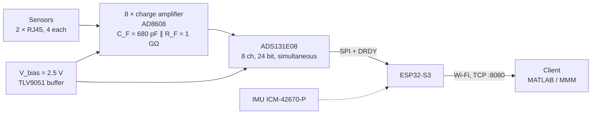
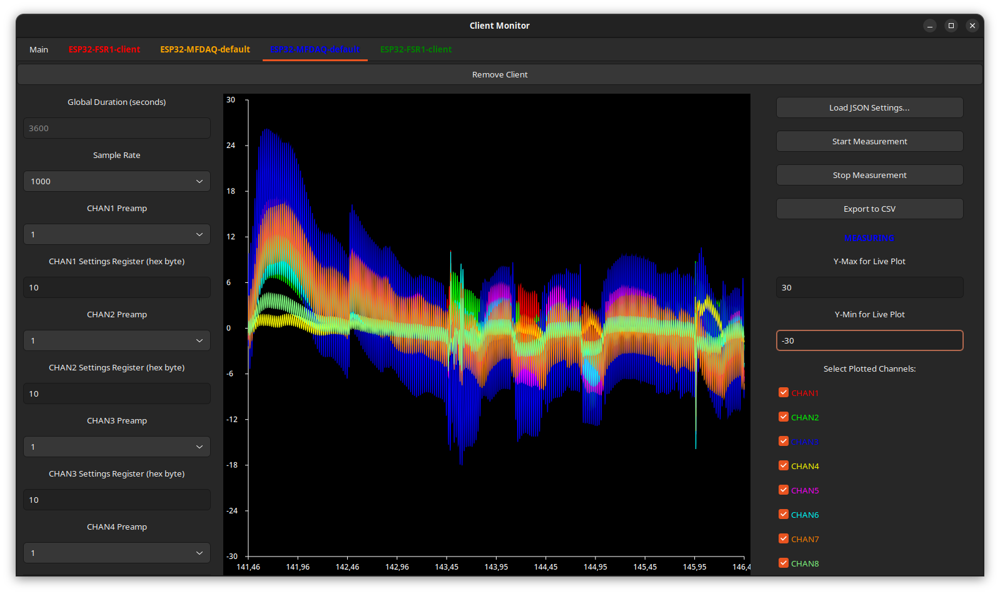

# Multi-Ferro-DAQ

**Wearable 8-channel charge amplifier and data acquisition system for piezo- and ferroelectric sensors.**

The system reads up to **8 charge sources simultaneously** via **two RJ45 connectors** (4 sensors per connector).
The PCB is designed for **mobile use**: it can be strapped to a test person, runs on **battery power**, and streams data in **millivolts (mV)** via **Wi-Fi** at up to **2000 samples per second**.

---

## 📋 Specifications

| Parameter | Value |
|---|---|
| Channels | 8, simultaneously sampled |
| ADC | TI ADS131E08, 24 bit ΔΣ, programmable gain G = 1, 2, 4, 8, 12 |
| Charge amplifier | AD8608 (quad CMOS op-amp), one per channel |
| Feedback network | C_F = 680 pF (C0G, ±5 %) ∥ R_F = 1 GΩ (±10 %) |
| Sensitivity | 1 / C_F ≈ 1.47 mV/pC |
| Time constant / lower cut-off | τ = R_F · C_F = 0.68 s → f_c = 1 / (2π τ) ≈ 0.23 Hz |
| Output range (vs. V_bias) | ±2.5 V at G = 1, ±4 V / G for G ≥ 2 |
| Charge range | ±1.70 nC at G = 1 (fault flag above ±2.375 V ≈ ±1.62 nC) |
| Sample rate | 1–2 kSa/s recommended (ADC supports up to 64 kSa/s, but samples are lost above 2 kSa/s) |
| Microcontroller | ESP32-S3-MINI-1-N8 |
| Data interface | Wi-Fi 2.4 GHz access point, TCP port 8080 |
| Power | 1S Li-ion/LiPo (protected cell, JST-PH) or USB-C; on-board charger ≈ 336 mA |
| On-board supplies | 5 V analog (LM2775 charge pump), 3.3 V digital (TPS7A91 LDO), V_bias = 2.5 V |
| Extras | 6-axis IMU (ICM-42670-P), 2 RGB status LEDs, board-level RF shield over the analog front end |
| PCB | 4 layers, 50 mm × 65 mm |

---

## ⚙️ How it works

**Analog front end.** The board runs from a single 5 V analog supply. To process bipolar charge signals, all analog circuitry is referenced to a mid-supply voltage **V_bias = 2.5 V**. V_bias is generated by the ADS131E08's internal op-amp and buffered by a TLV9051. Each channel is an inverting charge amplifier: the non-inverting input is tied to V_bias, the inverting input is the summing node the sensor connects to, and C_F ∥ R_F form the feedback. R_F provides the DC path that keeps the output from drifting, and sets the lower cut-off frequency.

**Digitization.** The ADS131E08 samples all eight amplifier outputs simultaneously and measures each one differentially against V_bias, so the result is the amplifier's output voltage relative to mid-supply. The analog front end and the ADC sit under a board-level RF shield.

**Firmware.** The ESP32-S3 uses both cores. An interrupt on the ADC's DRDY signal reads each sample into a queue. A second task converts the raw values to mV, removes the selected PGA gain, and sends packets of 64 samples to the client over TCP.

**Power.** The board runs from a 1S Li-ion/LiPo cell or USB-C. A TP4056 charges the cell from USB. An LM2775 charge pump supplies the 5 V analog rail, and a TPS7A91 low-noise LDO supplies the 3.3 V digital rail.

---

## 🧮 Converting the output to charge

The firmware streams each channel as the amplifier output voltage U (in mV, relative to V_bias, with the PGA gain already removed).
For signal frequencies well above the cut-off f_c ≈ 0.23 Hz, the charge Q delivered by the sensor into the amplifier input is

$$Q = -C_F \cdot U$$

With C_F = 680 pF:

$$Q\,[\mathrm{pC}] = -0.68 \cdot U\,[\mathrm{mV}]$$

Example: U = 100 mV → Q = −68 pC. The amplifier is inverting, so the sign of the output is opposite to the sign of the charge flowing into the input.

The feedback resistor makes the amplifier a high-pass. A charge step decays as e^(−t/τ) with τ = 0.68 s: after 0.68 s only 37 % of the step remains, and after 3.4 s (5τ) less than 1 %. For slow or quasi-static signals, correct for this with the transfer function

$$H(f) = -\frac{1}{C_F} \cdot \frac{j 2\pi f \tau}{1 + j 2\pi f \tau}$$

---

## 🔌 Sensor connection (RJ45 pinout)

Each RJ45 port carries four sensors. Each sensor uses one wire pair: one pin goes to the amplifier input (**signal**), the other to **V_bias**. Pin numbers follow the jack; wire colors follow the T-568B standard.

| Pair | Signal pin | V_bias pin | Signal wire / V_bias wire (T-568B) | Port I | Port II |
|---|---|---|---|---|---|
| A | 5 | 4 | white-blue / blue | IN4 | IN8 |
| B | 2 | 1 | orange / white-orange | IN3 | IN7 |
| C | 6 | 3 | green / white-green | IN2 | IN6 |
| D | 8 | 7 | brown / white-brown | IN1 | IN5 |

INx corresponds to CHANx in the data stream.

> **Important:** the V_bias pins sit at **2.5 V above board ground**. Never connect them to GND or to the cable shield. Shorting V_bias to ground loads the reference and drives the channels into saturation. Use the RJ45 shield for the cable screen. It connects to the board's shield net.

The pinout is also printed on the PCB silkscreen.

---

## 🛠️ Building the hardware

1. **Order the PCB with assembly** (e.g. JLCPCB) using the files in [`PCB/jlcpcb/production_files`](PCB/jlcpcb/production_files): Gerber archive, BOM and CPL.
   - 4-layer board, stackup JLC041611-3313, 1 oz inner copper (see `PCB/jlcpcb/Added Info.txt`).
2. **Order separately** (not part of the assembly BOM):
   - Laird **BMI-S-204-C** RF shield cover.
   - A **protected** 1S Li-ion/LiPo cell with a JST-PH 2-pin plug. The on-board TP4056 charger has no cell protection.
   - RJ45 cables or adapters for your sensors.
3. **After assembly:**
   - Press the shield cover onto the soldered J7 frame.
   - Check the solder jumpers. The factory states are listed in the BOM documentation.
   - Connect the battery and flash the firmware (see below).

The complete bill of materials, with manufacturer part numbers, key specs and datasheet links, is in [`PCB/BOM`](PCB/BOM/README.md) ([CSV](PCB/BOM/BOM_Multi-Ferro-DAQ_v1.3.csv)). The design files require **KiCad 9**. All project-specific symbols, footprints and 3D models are in `PCB/components`.

---

## ⚡ Flashing the firmware

The ESP32-S3 is flashed with the Arduino IDE using
`Software/ADC_readout/ardu_adc_dual_core_wifi_tcp/ardu_adc_dual_core_wifi_tcp.ino`.
The sketch includes the driver from `Software/ADC_readout/lib/`, so keep the folder structure intact.

**Required:**
- Arduino-ESP32 core (Espressif), installed via the Boards Manager
- FastLED library
- ArduinoJson library (only for the MultiMeasurementMonitor firmware)

**Board settings** (Tools menu):

| Setting | Value |
|---|---|
| Board | Adafruit Feather ESP32-S3 No PSRAM |
| USB CDC On Boot | Enabled |
| CPU Frequency | 240 MHz (WiFi) |
| Events Run On | **Core 0** |
| Arduino Runs On | **Core 0** |
| Flash Mode | QIO 80 MHz |
| Flash Size | 8 MB (64 Mb) |
| Partition Scheme | TinyUF2 8MB (2MB APP/3.7MB FATFS) |
| Upload Mode | USB-OTG CDC (TinyUSB) |
| USB Mode | USB-OTG (TinyUSB) |

For the first flash, or if the upload fails, put the ESP32 into programming mode: press and hold **BOOT**, briefly press **RESET**, then release BOOT. The ESP32 is then detected automatically, or can be selected as an "ESP32 Family Device" under the port selection.

Only enter programming mode after a compile/upload for the board above has started. Otherwise the IDE tries, and fails, to build for an "ESP32 Family Device".

The firmware is tested with the MATLAB script [`Software/ADC_readout/Matlab/ADC_WiFi_readout_TCP.m`](Software/ADC_readout/Matlab/ADC_WiFi_readout_TCP.m) using MATLAB R2024b.

---

## 🧩 Setup

### 1. Power On
- Flip the power switch to **ON**, or **reset** the powered-on PCB.
- During startup, the **status LED** turns **YELLOW**, indicating the setup phase.

### 2. Ready State
- When the LED turns **MAGENTA**, the ESP32 is ready to start a measurement.
- A **white flash** under the shielding of the charge amplifiers and ADC indicates that the ADC is set up and communicating.

### 3. Wi-Fi Connection
Connect to the ESP32's Wi-Fi hotspot:

- SSID: `ESP32_Hotspot`
- Password: `123456789`

Then connect to **IP address 192.168.4.1** on **TCP port 8080**
(see this [MATLAB script](Software/ADC_readout/Matlab/ADC_WiFi_readout_TCP.m) for details).

> The hotspot credentials are hard-coded in the firmware. Change them in the sketch if the board is used outside the lab.

### 4. Initialization
The ESP32 expects initialization values in a **fixed format and order** (36 bytes, little-endian).
Garbage bytes can be sent to initialize with the ADC's own default values.

| Data Type | Count | Description |
|------------|--------|-------------|
| `int64` | 1 | Maximum number of samples to collect (PCB resets afterwards). |
| `uint32` | 1 | ADC sample rate. Choose from `1000, 2000, 4000, 8000, 16000, 32000, 64000`.  Rates above **2000** cause sample loss and are **not recommended**. |
| `uint16` | 8 | ADC settings registers for **CHAN1–CHAN8**.  Only the lower byte is used; set the upper byte to zero. |
| `uint8` | 8 | PGA gain for **CHAN1–CHAN8** (1, 2, 4, 8 or 12).  These overwrite the gain previously set in the settings registers. The microcontroller removes the gain before transmitting the data. |

### 5. Start Measurement
Once initialized, the **status LED turns GREEN**. It stays green until:
- the measurement **times out**, or
- it is **stopped** manually.

---

## 🔋 Power Supply

- The PCB can be powered via **USB-C** or the **battery port**.
- The battery is **charged directly by the PCB**.

**Battery indicator LED:**
- **Solid RED:** battery is charging.
- **Fast blinking RED (while powered on):** no battery detected.

---

## 📡 Usage

After setup, the microcontroller sends data via **TCP** to the client until:
- the measurement **times out**, or
- it is **stopped** by the client sending **any byte** via TCP.

### Data Output Format

The TCP stream consists of samples of **nine little-endian `float32` values** (36 bytes per sample), sent in packets of 64 samples (2304 bytes):

| Channel | Description |
|----------|--------------|
| **CHAN1–CHAN8** | Amplifier output in mV relative to V_bias (`–2500 mV` to `+2500 mV`). See [Converting the output to charge](#-converting-the-output-to-charge). |
| **CHAN9** | Timestamp in µs since the last ESP32 reset |

**Fault Flags:**
- A value of `–9999 mV` or `+9999 mV` means the ADC's **negative or positive fault flag** was triggered.
  This happens when the measured value exceeds **±2375 mV** (≈ 95 % of the input range).

**Timestamp resolution:** the timestamp is transmitted as `float32`, so its resolution decreases with time since reset. The step size is 2 µs after 16.8 s, 64 µs after 9 min, and 512 µs after 71.6 min. Reset the board before long measurements if exact sample timing matters.

---

## 📡 Usage with MultiMeasurementMonitor

The DAQ can also be used as a client for the MMM (MultiMeasurementMonitor) project with this [firmware](Software/MMM_Migration).

The available settings stay the same, but you get the benefits of the MMM. The ClientName is set via the JSON file when programming, and the Wi-Fi credentials can be changed via the Serial Monitor at startup.

For further details on using clients with the MMM, see the [MMM project on GitHub](https://github.com/TUDA-MUST/Multi-Measurement-Monitor).

---

## 🔁 Post-Measurement

- After a measurement ends, the PCB **automatically reinitializes**.
- It is ready again when the **status LED turns MAGENTA**.
- The PCB can also be **reinitialized manually** by pressing **RESET**.

---

## 🧭 Additional Features

- An **IMU** (ICM-42670-P) is included on the PCB.
  It has been tested, but is **not used** by the current firmware.

---

## 📄 License

| Content | License |
|---|---|
| Hardware (PCB design and production files) | [CERN-OHL-W-2.0](LICENSES/CERN-OHL-W-2.0.txt) |
| Software (firmware, scripts) | [MIT](LICENSES/MIT.txt) |
| Documentation and images | [CC BY 4.0](LICENSES/CC-BY-4.0.txt) |

Copyright (c) 2024–2026 Measurement and Sensor Technology Group (MUST), TU Darmstadt and contributors.
See [LICENSE](LICENSE) for details and [THIRD_PARTY_NOTICES.md](THIRD_PARTY_NOTICES.md) for third-party components.

## 📝 Citation

If you use Multi-Ferro-DAQ in your research, please cite it using the metadata in [CITATION.cff](CITATION.cff) (GitHub: "Cite this repository").

---

## 🙏 Acknowledgements

- The ADS131E08 driver is based on the [ads131e08](https://github.com/mcjun37/ads131e08) STM32 library by **Minchul Jun**,
  ported to the ESP32 by **Thomas Schreck**. See [THIRD_PARTY_NOTICES.md](THIRD_PARTY_NOTICES.md) for its license.

Developed at the [Measurement and Sensor Technology Group (MUST)](https://www.etit.tu-darmstadt.de/must/), Technische Universität Darmstadt.
