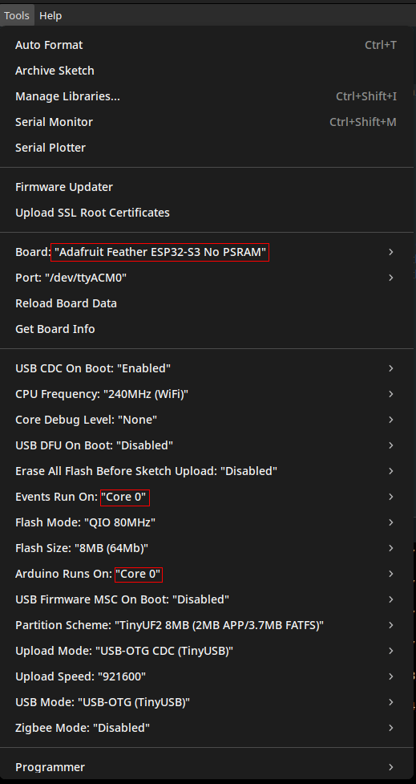

# Multi-Ferro-DAQ

**Measurement setup to analyze up to eight charge sources (e.g. ferroelectric sensors) simultaneously.**

The system connects up to **8 channels** via **two RJ45 connectors** (4 sources per connector).  
The PCB is designed for **mobile use** — it can be strapped to a test person, runs on **battery power**, and transmits data in **millivolts (mV)** via **WiFi** at up to **2000 samples per second**.

The **ESP32 microcontrollers** on the PCB should be flashed with the Arduino script located at:  
`/Software/ADC_readout/ardu_adc_dual_core_wifi_tcp/ardu_adc_dual_core_wifi_tcp.ino`

---

## ⚡ Flashing
The ESP32 microcontroller can be flashed with the Arduiono IDE, using the .ino script mentioned above. 
Make sure you have the necessary libraries installed as well as the `/Software/ADC_readout/lib/` directory.

Select an ESP32-S3 board without SRAM and make shure that Events and Arduino run on Core 0.

If you do an initial flashing of the board or encounter some issues during upload try to restart the ESP32 into programming mode by pressing and holding the "BOOT" button while shortly pressing the "RESET" button. Afterwards the ESP32 will be detected automatically as a target or can be selected as an "ESP32 Family Device" under the port/device selection.

Use this programming-mode procedure only after a compile/ upload process for an ESP32-S3 without SRAM was started, as the IDE otherwise tries and fails to build for an "ESP32 Family Device".

The Arduino script is tested to be working with the MATLAB script `/Software/ADC_readout/Matlab/ADC_WiFi_readout_TCP.m` using MATLAB R2024b.

---

## 🧩 Setup

### 1. Power On
- Flip the power switch to **ON** or **reset** the powered on PCB.  
- During startup, the **status LED** turns **YELLOW**, indicating the setup phase.

### 2. Ready State
- When the LED turns **MAGENTA**, the ESP32 is ready to start a measurement.  
- A **white flash** under the shielding of the charge amplifiers and ADC indicates that the ADC is set up and communicating.

### 3. WiFi Connection
Connect to the ESP32’s WiFi hotspot:

- SSID: ESP32_Hotspot
- Password: 123456789

Then connect to **IP Adress 192.168.4.1** under **TCP port 8080** to communicate.

### 4. Initialization
The ESP32 expects initialization values in a **hardcoded format and order**.  
Garbage bytes can be sent to initialize with the ADCs own default values.

| Data Type | Count | Description |
|------------|--------|-------------|
| `int64` | 1 | Maximum number of samples to collect (PCB resets afterward). |
| `uint32` | 1 | ADC sample rate — choose from: `1000, 2000, 4000, 8000, 16000, 32000, 64000`.  Rates above **2000** cause sample loss and are **not recommended**. |
| `uint16` | 8 | ADC settings registers for **CHAN1–CHAN8**.  Only the lower byte is used; set the upper byte to zero. |
| `uint8` | 8 | Preamp values for **CHAN1–CHAN8**.  These overwrite previously set register values. The preamp value is factored out by the microcontroller before data transmission. |

For a working example, see the MATLAB script:  
`/Software/ADC_readout/Matlab/ADC_WiFi_readout_TCP.m`

### 5. Start Measurement
Once initialized, the **status LED turns GREEN** and remains green until:
- The measurement **times out**, or  
- It is **stopped** manually.

---

## 🔋 Power Supply

- The PCB can be powered via **USB-C** or **battery port**.  
- The battery can be **charged directly by the PCB**.

**Battery indicator LED behavior:**
- **Solid RED:** Battery is charging.  
- **Fast blinking RED (while powered on):** No battery detected.

---

## 📡 Usage

After setup, the microcontroller begins sending data via **TCP packets** to the client until:
- The measurement **times out**, or  
- It is **stopped** by being sent **any byte** via TCP by the recieving client.

### Data Output Format

The TCP stream contains **segments of nine floats** per sample:

| Channel | Description |
|----------|--------------|
| **CHAN1–CHAN8** | ADC values in mV (`–2500 mV` to `+2500 mV`) |
| **CHAN9** | Timestamp (in µs) since the last ESP32 reset |

**Fault Flags:**
- A value of `–9999 mV` or `+9999 mV` indicates that the ADC’s **negative or positive fault flag** was triggered.  
  This occurs when the measured value exceeds **±2375 mV** (≈95% of input range).

---

## 🔁 Post-Measurement

- After a measurement ends, the PCB **automatically reinitializes**.  
- It is ready again when the **status LED turns MAGENTA**.  
- The PCB can also be **reinitialized manually** by pressing the **RESET** button.

---

## 🧭 Additional Features

- An **IMU** is included on the PCB.  
  Although tested, it is **not used** in the current firmware version running on the ESP32.

---

<!--# Multi-Ferro-DAQ
Measurement Setup to analyze up to eight sources of charge (e.g. ferroelectric sensors) simultaneously. Those can be connected via two RJ45 connectors, four sorces per connector.
The PCB aims to be used mobile, strapped to the test person, therefore it batterypowered and transmits its data in mV per WiFi with up to 2000 samples per second.
The ESP32 microcontrolers on the PCB should be flashed with the Arduino script in /ADC/ardu_adc_dual_core_wifi_tcp/ardu_adc_dual_core_wifi_tcp.ino.

# Setup:

After flipping the powerswitch to ON or resetting the PCB, at startup, the ESP32 cycles through a setup phase during which the status LED turns YELLOW. When the status LED turns MAGENTA, the EPS32 is ready to start a measurement. A white Flash under the shielding of the charge amplifiers and the ADC signals that the ADC was setup and is communicating. Connect to the WiFi Hotspot the ESP32 creates with the 

SSID "ESP32_Hotspot" and 

password "123456789".

Afterwards you can communicate with it on TCP port 8080.  

The ESP32 expects to be handed some initialization values in a hardcoded format and order. Garbage bytes can be sent and the ESP32 will initialize with default values:

1. 1x int64:  the maximum number of samples to collect in this measurement (The PCB will reset itself afterwards).
2. 1x uint32: the sample rate of the ADC (1000, 2000, 4000, 8000, 16000, 32000, 64000). Sample rates above 2000 will result in sample loss and are not recommended.
3. 8x uint16: the settings-registers for CHAN1-CHAN8 of the ADC. As only the lower byte is utilized, set the upper byte to zero.
4. 8x uint8:  the preamp values for the individual channels from CHAN1 to CHAN8. This will overwrite the preamp values previously set in the settins-registers. The preamp value will be factored out by the microcontroller before sending the data.

For further deatails and a working example look inside the MATLAB script /ADC/Matlab/ADC_WiFi_readout_TCP.m.

Afterwards the status LED should turn GREEN and will remain GREEN until the measurement times out or is stopped by the user.

The PCB can be powered via the USB-C or the battery port. The battery can be charged by the PCB. If the RED battery indicator LED is glowing steadily, the battery is being charged, if the indicator LED is blinking fast, while the PCB is powered on, no battery was detected.

# Usage:

After setup the microcontroller will send the data in TCP packages to a client until the timeout is reached or the measurement is stopped by sending any byte to the microcontroller via TCP. The incoming bytesream consists of segments of nine floats that represent a sample. The first eight floats are the values of CHAN1 to CHAN8 of the ADC in mv and are in a range from -2500mV to +2500mV. The ninth channel is the timestamp of the sample in µs in regards to when the ESP32 was last reset. If a channel reads -9999mV or +9999mV the negative or positive fault flags of the ADC were activated and the measured value exceeds -2375mV or +2375mV, or 95% of the input range.

After a measurement has ended, the PCB will automatically be reinitialized and is ready again, as soon as the status LED turns MAGENTA. Alternatively the PCB can be reinitialized by pressing the RESET button.

There is also an IMU placed on the PCB which is tested, but not used in the current version of the code running on the ESP32. -->
